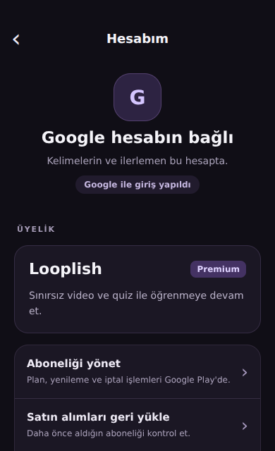
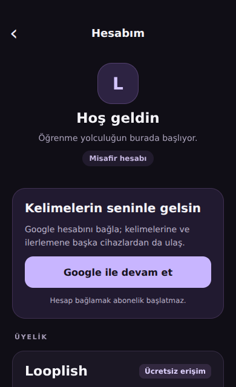
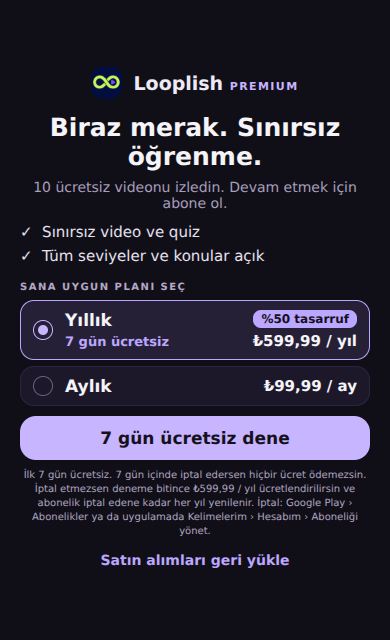

# Hesap ve abonelik ekranları

Başlangıç: `feat/firebase-auth-guest-paywall`, `c064129`.

- Kelimelerim başlığındaki **Hesabım** düğmesi ayrı, kaydırılabilir hesap panelini açar.
- Misafirde Google hesabı bağlama gösterilir; hesap bağlamak ödeme başlatmaz.
- Bağlı hesapta abonelik durumu backend'den doğrulanır. Ağ hatası ücretsiz/Premium sayılmaz.
- Aboneliği yönet Google Play'i açar; geri yükleme ve durum yenileme paneldedir.
- Çıkış açıklamalı onay ister. Hesap işlemleri sırasında yinelenen istekler engellenir.
- Paywall paket ve deneme bilgilerini mağazadan almaya devam eder; yükleme hatası tekrar denenebilir.
- Kısa feed alanları için kompakt paywall düzeni vardır.

## Görsel kontrol

Aşağıdaki görseller gerçek TSX bileşenlerinin React Native Web ile 390px genişlikte
render edilmesidir. Firebase/RevenueCat ve safe-area bilgileri önizlemede taklittir;
fiyatlar örnektir. Görseller native cihaz veya gerçek ödeme doğrulaması değildir.
Hesap panelinin devamı aşağı kaydırılarak açılır.

| Bağlı hesap | Misafir | Paywall |
| --- | --- | --- |
|  |  |  |

## Cihazda kontrol

- Kelimelerim → Hesabım → geri: seçili kelime sekmesi korunmalı.
- Android geri tuşu hesabı kapatmalı; sistem çubukları içeriği kapatmamalı.
- Google bağlama, mağaza yönetimi, geri yükleme, çıkış ve tekrar giriş denenmeli.
- Dar ekran, büyük yazı ayarı ve mevcut offering'deki tüm planlar kontrol edilmeli.

API, veritabanı, production env ve abonelik kapısı bu değişiklikte değiştirilmez.
